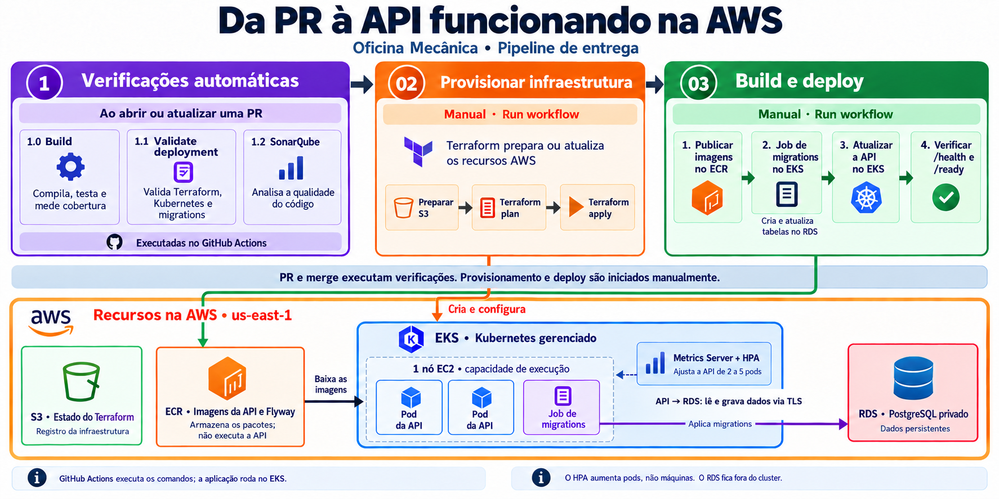

# 🔧 POS FIAP — Oficina Mecânica

Backend do Tech Challenge da FIAP para gestão de clientes, veículos, estoque,
orçamentos e ordens de serviço de uma oficina mecânica. Desenvolvido em Go, com
PostgreSQL, Clean Architecture e princípios de Domain-Driven Design (DDD).

A aplicação pode ser executada de três formas, com bancos e dados independentes:

| Ambiente | Uso | Como executar |
| --- | --- | --- |
| Docker Compose | Desenvolvimento no computador | `make setup` |
| Kubernetes local | Execução e testes de infraestrutura com Kind | [Guia local](infra/local/README.md) |
| AWS Academy | Provisionamento com Terraform e deploy no EKS | [Automação AWS](infra/aws/AUTOMACAO.md) |

Para usar Kubernetes, não é necessário iniciar antes a aplicação pelo Compose.
No ambiente local, Kind utiliza Docker como base para executar o cluster.

## 📑 Conteúdo

- [Arquitetura](#arquitetura)
- [Modelagem de dados](#modelagem-de-dados)
- [Por que PostgreSQL](#por-que-postgresql)
- [Pré-requisitos e execução local](#execucao-local)
- [Kubernetes local](#kubernetes-local)
- [Infraestrutura AWS e Terraform](#infraestrutura-aws)
- [CI/CD e workflows](#cicd)
- [APIs e testes](#apis-e-testes)
- [Persistência e HPA](#persistencia-e-hpa)
- [Encerramento](#encerramento)
- [Estrutura de pastas](#estrutura)
- [Segurança](#seguranca)
- [Documentação complementar](#documentacao)
- [Integrantes](#integrantes)

<a id="arquitetura"></a>

## 🏗️ Arquitetura

O projeto utiliza **Clean Architecture**, mantendo a organização por contextos de
negócio e os princípios de Domain-Driven Design (DDD).

- **`domain`**: entidades, valores e regras de negócio.
- **`application`**: casos de uso e interfaces de persistência e serviços externos.
- **`presentation`**: entrada HTTP e conversão de requisições/respostas.
- **`infrastructure`**: implementações de PostgreSQL, JWT, bcrypt e notificações.
- **`cmd/oficina-mecanica`**: composição das dependências e inicialização da API.
- **`shared`**: validações de valores e recursos técnicos compartilhados, respeitando
  as dependências permitidas por camada.

Os casos de uso dependem de contratos e recebem os adaptadores na inicialização.
Os testes em `tests/architecture` verificam automaticamente a direção das
dependências. O desenho e os exemplos implementados estão em
[Clean Architecture](docs/07-clean-architecture.md).

<a id="modelagem-de-dados"></a>

## 🗃️ Modelagem de dados

O [Modelo Entidade-Relacionamento](docs/04-modelo-entidade-relacionamento.md)
apresenta as entidades, os relacionamentos e as decisões de modelagem.

- `db/migrations/`: scripts SQL de criação e evolução do schema.
- `db/seeds/`: dados iniciais para desenvolvimento e demonstração local.
- `Dockerfile.migrations`: imagem Flyway usada pelo deploy AWS para aplicar
  migrations pendentes e registrar versões e checksums.

Terraform cria a infraestrutura do banco; as migrations criam e atualizam as
tabelas. O deploy AWS não carrega o seed automaticamente.

<a id="por-que-postgresql"></a>

## 🗄️ Por que PostgreSQL

O banco de dados principal da API é o **PostgreSQL**, um banco **SQL relacional**. A decisão
foi tomada porque o domínio da oficina é fortemente relacional e transacional: clientes,
veículos, ordens de serviço, orçamentos, peças/insumos e movimentações de estoque se
relacionam entre si e precisam permanecer consistentes mesmo quando várias entidades são
alteradas na mesma operação (por exemplo, dar baixa em um item de estoque ao mesmo tempo em
que se registra o consumo em uma ordem de serviço).

Principais motivos:

- **Relacionamentos nativos** — chaves estrangeiras e `JOIN`s representam naturalmente as
  relações um-para-muitos e muitos-para-muitos do domínio (um cliente com vários veículos, uma
  ordem de serviço com vários itens de estoque, etc.).
- **Integridade referencial no próprio banco** — restrições como `FOREIGN KEY`, `NOT NULL`,
  `UNIQUE` e `CHECK` evitam estados inválidos (ex.: ordem de serviço para veículo inexistente)
  independentemente de qual código acessa o banco.
- **Transações ACID** — operações que precisam ser "tudo ou nada", como aprovar um orçamento,
  reservar itens de estoque e atualizar a ordem de serviço, são executadas de forma atômica.
- **Consultas e relatórios cruzados** — SQL é adequado para os relatórios operacionais do
  domínio (tempo médio de execução, fila de atendimento, itens abaixo do mínimo, histórico por
  cliente/veículo), que cruzam várias entidades.
- **Flexibilidade quando necessário** — o tipo `JSONB` permite armazenar atributos variáveis
  (ex.: dados específicos de diagnóstico) sem abrir mão do modelo relacional no núcleo do
  sistema.

Alternativas NoSQL (como MongoDB) foram avaliadas e descartadas como banco principal: elas são
tecnicamente capazes, mas deslocariam para a aplicação parte do trabalho de integridade e
consistência que o PostgreSQL já resolve nativamente, sem trazer vantagem clara para este
domínio (não há requisito de dados extremamente heterogêneos, agregados independentes ou
escala horizontal extrema que justifique essa troca). A análise completa está registrada em
[docs/02-decisoes-arquiteturais.md](docs/02-decisoes-arquiteturais.md) e no
[Modelo Entidade-Relacionamento](docs/04-modelo-entidade-relacionamento.md).

<a id="execucao-local"></a>

## 🛠️ Pré-requisitos e execução com Docker Compose

Instale Git, Docker Desktop (containers Linux) ou Docker Engine, Docker Compose
e GNU Make. No Windows, execute os comandos `make` pelo Git Bash.
Go e PostgreSQL não precisam estar instalados no computador para esse fluxo.

Da pasta em que deseja clonar o projeto:

```bash
git clone https://github.com/Tech-Challenge-17SOAT-Oficina-Mecanica/pos-fiap-oficina-mecanica.git
cd pos-fiap-oficina-mecanica
cp .env.example .env
```

Ajuste o `.env` para seu ambiente; os valores de exemplo são destinados ao uso
local. Não versione credenciais reais. O arquivo `.env` é ignorado pelo Git.

Na primeira execução, prepare o banco e inicie os containers:

```bash
make setup
curl --fail http://localhost:8080/health
curl --fail http://localhost:8080/ready
```

`make setup` inicia o PostgreSQL, aplica os SQLs, carrega o seed e constrói os
containers. Use-o para a preparação inicial de um banco vazio; as migrations desse
caminho usam `psql`, sem o histórico do Flyway utilizado na AWS.

| Situação | Comando |
| --- | --- |
| Iniciar novamente um ambiente já preparado | `make up` |
| Incorporar mudanças no código Go à API | `docker compose up -d --build app` |
| Conferir os containers | `docker compose ps` |
| Acompanhar os logs da API | `docker compose logs -f app` |
| Conferir os dados iniciais | `make db-verify` |
| Listar os comandos disponíveis | `make help` |

<a id="kubernetes-local"></a>

## ☸️ Kubernetes local

Instale também Terraform, kubectl e a CLI Kind, com Docker Desktop iniciado.
No Windows, execute da raiz do repositório:

```bash
powershell.exe -NoProfile -ExecutionPolicy Bypass -File scripts/provisionar-infra.ps1
```

O script prepara o armazenamento persistente, cria ou reutiliza o cluster Kind e
provisiona o PostgreSQL. As credenciais e os estados locais não são versionados.

Depois, prepare o schema, instale Metrics Server, carregue a imagem da API no Kind
e aplique API e HPA seguindo o [guia local completo](infra/local/README.md).
**O script acima prepara a infraestrutura; ele não faz sozinho o deploy da API.**

Os manifestos são separados em `k8s/base`, `k8s/local` e `k8s/aws`.
Consulte a [organização Kubernetes](k8s/README.md) antes de aplicar arquivos:
namespace, credenciais e banco têm recursos gerenciados pelo Terraform.

<a id="infraestrutura-aws"></a>

## ☁️ Infraestrutura AWS e Terraform

A infraestrutura usa a região `us-east-1` e os seguintes componentes:

| Componente | Responsabilidade |
| --- | --- |
| EKS e um nó EC2 | Executar o Kubernetes e os pods da aplicação |
| RDS PostgreSQL 16 | Banco privado, separado do cluster, com armazenamento persistente |
| ECR | Armazenar as imagens da API e das migrations |
| S3 | Guardar estados Terraform separados por conta e módulo |
| Metrics Server e HPA | Medir consumo e ajustar a quantidade de cópias da API |

O RDS aceita conexões do grupo de segurança do EKS. A API usa TLS para acessar o
banco. Um único nó e um banco Single-AZ são escolhas de laboratório e não oferecem
alta disponibilidade. O ambiente AWS consome os créditos da conta Academy.

O Terraform está dividido em:

- `infra/aws/state`: configuração do armazenamento dos estados.
- `infra/aws/cluster`: EKS, nó, RDS, regras de acesso, ECR e Metrics Server.
- `infra/aws/platform`: namespace, ConfigMap e Secret no Kubernetes existente.

Em `Settings → Secrets and variables → Actions`, configure:

Na aba **Variables**, crie a variável de repositório **`AWS_ACCOUNT_ID`** com o ID
de 12 dígitos da conta das credenciais AWS. O workflow lê `vars.AWS_ACCOUNT_ID`;
cadastrá-la somente em **Secrets** não fornece esse valor.

Na aba **Secrets**, configure:

| Secret | Finalidade |
| --- | --- |
| `AWS_ACCESS_KEY_ID` | Chave de acesso temporária do Academy |
| `AWS_SECRET_ACCESS_KEY` | Chave secreta da mesma sessão |
| `AWS_SESSION_TOKEN` | Token da mesma sessão |
| `AWS_DB_PASSWORD` | Senha estável do RDS: 16+ caracteres, letras, números, `_` ou `-` |
| `AWS_JWT_SECRET` | Chave estável da API na AWS, com pelo menos 32 caracteres |
| `CI_DB_PASSWORD` | Senha do banco temporário dos testes |
| `JWT_SECRET` | Chave de autenticação dos testes |
| `SONAR_TOKEN` | Token para análise de qualidade |

As credenciais temporárias devem pertencer à conta escolhida e estar válidas.
Renovar a sessão não exige mudar a senha do banco nem a chave JWT da aplicação.
`AWS_REGION` e `ECR_URI` não são necessários como secrets nos workflows atuais.

Para uma conta nova, execute o provisionamento e depois o deploy conforme a próxima
seção. Se já houver EKS/RDS com os mesmos nomes, mas sem estado remoto, o fluxo
bloqueia: é necessário planejar a importação ou migrar o estado local existente.
Não execute uma recriação para contornar essa situação sem avaliar os dados.

Pré-requisitos da conta, variáveis opcionais e instruções completas:
[infraestrutura AWS](infra/aws/README.md) e [automação](infra/aws/AUTOMACAO.md).

<a id="cicd"></a>

## ⚙️ CI/CD e workflows



### Por que precisamos do bucket S3?

Um **bucket** é um espaço de armazenamento do Amazon S3. No nosso fluxo, ele
guarda o **estado do Terraform**: o registro que relaciona os arquivos de
infraestrutura aos recursos criados na AWS, como o cluster EKS e o banco RDS.

Cada execução do GitHub Actions usa uma máquina temporária. O bucket permite que
a próxima execução consulte esse registro e saiba quais recursos já administra,
o que precisa criar e o que precisa atualizar. Sem o estado correspondente, o
Terraform não adota automaticamente um cluster ou banco existente; nossa
automação bloqueia esse caso para evitar conflitos.

O provisionamento prepara o bucket automaticamente, antes dos demais recursos.
Cada conta usa seu próprio bucket, com registros separados para armazenamento
(`bootstrap/terraform.tfstate`), infraestrutura (`cluster/terraform.tfstate`) e
configurações Kubernetes (`platform/terraform.tfstate`). O versionamento preserva
versões anteriores; o bloqueio de estado evita alterações concorrentes no mesmo
registro. O armazenamento tem criptografia e bloqueio de acesso público.

**O bucket guarda o registro da infraestrutura; os dados da oficina ficam no RDS
e as imagens ficam no ECR.** O estado pode conter credenciais, por isso não deve
ser público nem versionado no Git. Preserve o bucket enquanto houver recursos
administrados por esses estados.

### Papel dos recursos e serviços AWS

| Recurso ou serviço | Papel no nosso fluxo |
| --- | --- |
| **S3** | Mantém os estados Terraform entre execuções da pipeline, com versionamento e bloqueio para alterações concorrentes. |
| **ECR** | Guarda as imagens Docker da API e do Flyway com tags do commit. O EKS baixa essas imagens para executá-las; publicar no ECR não inicia a aplicação. |
| **EKS** | Fornece o Kubernetes gerenciado, que administra os pods, Services, Jobs e a atualização da API. |
| **EC2** | Fornece a máquina do grupo de nós do EKS, onde executam os containers da API, das migrations e dos componentes Kubernetes. Nosso laboratório usa um nó. |
| **RDS PostgreSQL** | Executa o banco privado e mantém os dados independentemente dos pods. O Job Flyway prepara as tabelas antes da atualização da API; a API acessa o banco usando TLS. |
| **VPC e sub-redes** | Definem a rede usada por EKS e RDS. O Terraform reutiliza a VPC e sub-redes existentes descobertas na conta Academy. |
| **Internet Gateway e rotas** | Oferecem o caminho de saída das sub-redes públicas usadas pelos nós para baixar imagens e acessar serviços. A pipeline verifica essa rota existente. |
| **Security Groups** | Controlam as conexões de rede. O grupo do banco permite PostgreSQL na porta 5432 somente a partir do grupo de segurança do EKS. |
| **IAM e acesso EKS** | Definem quais identidades podem provisionar recursos, publicar imagens e administrar o Kubernetes. O acesso de rede ao cluster é verificado separadamente. |

**GitHub Actions e Terraform** executam a automação; a aplicação permanece no
EKS após o término do workflow. **Metrics Server e HPA** são componentes do
Kubernetes: medem CPU/memória e ajustam a API entre 2 e 5 pods. Eles não aumentam
automaticamente o número de máquinas EC2.

### Funções IAM usadas no laboratório

Uma função IAM (*role*) é uma identidade com permissões. Ela tem um papel
diferente de um serviço de execução, como EKS ou RDS:

| Função | Quem a utiliza e para quê |
| --- | --- |
| **Função da sessão Academy**, como `voclabs` | A pipeline usa suas credenciais temporárias para executar Terraform e comandos AWS. Para operar dentro do Kubernetes, essa identidade também precisa de acesso autorizado no EKS. |
| **`LabEksClusterRole`** | O serviço EKS assume essa função para administrar os recursos AWS necessários ao cluster. |
| **`LabEksNodeRole`** | As máquinas EC2 do grupo de nós assumem essa função para participar do EKS, usar a rede Kubernetes e baixar imagens do ECR. |

Os nomes completos podem ter prefixos e sufixos próprios de cada conta. A
automação descobre as funções de cluster e nós já fornecidas pelo Academy, sem
criar novas funções IAM. Os Secrets do GitHub guardam as credenciais temporárias;
a Variable `AWS_ACCOUNT_ID` permite conferir se elas pertencem à conta esperada.

### Ordem de execução

Os gatilhos são definidos pelo campo `on:` nos arquivos de `.github/workflows/`.
Os números dos nomes servem para orientar a execução.

| Workflow | Quando executa | O que faz |
| --- | --- | --- |
| **1.0 · 🏗️ Build** | PR, push na `main` ou acionamento manual | Compila, executa testes e verifica cobertura mínima de 80% |
| **1.1 · 🔎 Validate deployment** | PR e push na `main` | Valida workflows, Terraform, manifestos, scripts e migrations |
| **1.2 · 📊 SonarQube** | Abertura/atualização/reabertura de PR e push na `main` | Analisa qualidade de código |
| **02 · 🏗️ Prepare AWS infrastructure** | Manual | Prepara o S3 internamente e cria ou atualiza a infraestrutura com Terraform |
| **03 · 🐳 Docker Build and Deploy** | Manual | Publica imagens, executa migrations, atualiza a API e valida `/health` e `/ready` |

As verificações `1.0`, `1.1` e `1.2` podem executar em paralelo.
**PR ou merge não dispara provisionamento nem deploy AWS.**

Para instalar em uma conta nova:

1. Aguarde as verificações do commit passarem.
2. Configure `AWS_ACCOUNT_ID` na aba **Variables** e os secrets da conta escolhida.
3. Acesse `Actions → 02 · Prepare AWS infrastructure → Run workflow`, selecione a
   branch desejada e, opcionalmente, informe seu IPv4 público com `/32` em
   `admin_cidr`. O clique em **Run workflow** inicia o provisionamento e pode consumir
   créditos; não há campo de ID da conta nem confirmação adicional.
4. Aguarde o término com sucesso. O cluster e o RDS estarão preparados, ainda sem a API.
5. Execute `03 · Docker Build and Deploy` na mesma conta e revisão aprovada.
6. Confira a conclusão das migrations, do rollout e das verificações HTTP nos logs.

Não existe workflow separado para preparar o S3: essa preparação faz parte da etapa `02`.
O deploy exige Build e Validate deployment aprovados para o mesmo commit.
Ele publica imagens no ECR com tags do commit e aplica migrations antes de atualizar
os pods da API. Publicar uma imagem no ECR, sozinho, não coloca a API em execução.

Para uma nova versão apenas da aplicação, execute as verificações e o deploy `03`.
Se houver mudanças na infraestrutura, execute também o provisionamento `02` antes
do deploy. Quando a branch receber novos commits, aguarde as verificações desse
novo commit e inicie uma nova execução; **Re-run jobs** repete o código da execução antiga.

O IP administrativo opcional permite usar `kubectl` no seu computador. Sem ele,
o endpoint Kubernetes permanece privado fora das execuções; a pipeline abre acesso
público somente para o IP do seu executor e o fecha ao terminar. Com o IP preenchido,
preserva esse acesso administrativo e remove somente o IP temporário do executor.
Isso se refere à administração do Kubernetes, não a uma URL pública da API da oficina.
Acesso, parâmetros e proteções estão
no [guia de automação](infra/aws/AUTOMACAO.md); detalhes do deploy no
[guia EKS](docs/06-deploy-eks.md).

<a id="apis-e-testes"></a>

## 🔗 Acesso às APIs e testes

No Docker Compose:

| Recurso | Endereço |
| --- | --- |
| Health check da API | <http://localhost:8080/health> |
| Readiness da API | <http://localhost:8080/ready> |
| Swagger UI | <http://localhost:8081> |
| Mailpit: mensagens de e-mail locais | <http://localhost:8025> |

No Kubernetes, o Service é interno. Após o deploy, com kubeconfig e acesso
configurados, encaminhe uma porta para usar a API no seu computador:

```bash
# AWS; para Kind, troque oficina-aws por kind-oficina.
kubectl --context oficina-aws -n oficina port-forward service/oficina-api 8080:80
```

Mantenha esse terminal aberto e, em outro terminal, consulte os endpoints:

```bash
curl --fail http://localhost:8080/health
curl --fail http://localhost:8080/ready
```

Esse encaminhamento não publica uma URL na internet. Swagger UI e Mailpit são
serviços do Compose e não são instalados pelo deploy AWS.

Para chamadas de negócio, abra a [coleção Bruno](bruno/oficina-mecanica), ajuste a
URL base e execute o fluxo de autenticação antes das rotas protegidas. Use o token
retornado como `Authorization: Bearer <token>`. O banco AWS não recebe os usuários
do seed local; prepare um usuário conforme o fluxo de cadastro do projeto.

Consulte também o [catálogo de endpoints](docs/03-endpoints.md) e a
[especificação OpenAPI](openapi.yaml).

Testes locais em containers:

```bash
make test
make coverage
```

`make coverage` gera `coverage.out`. Saúde e readiness não substituem um teste
funcional: valide também uma operação autenticada que grave e consulte o banco.

<a id="persistencia-e-hpa"></a>

## 📈 Validação de persistência e HPA

### Persistência

- **Compose:** o PostgreSQL usa o volume nomeado `postgres_data`.
- **Kind:** PV/PVC ligam o PostgreSQL ao diretório persistente preparado no computador.
- **AWS:** o banco fica no RDS, independente dos pods da API.

Cadastre e consulte um registro pela API. No Kind, recrie somente o pod do banco e
consulte o mesmo registro novamente; na AWS, recrie um pod da API e repita a consulta.
Isso verifica a continuidade dos dados nesse cenário, sem substituir testes de
backup e recuperação. Procedimento local: [persistência](infra/local/README.md).

### Escala automática

O HPA está configurado para manter **2 a 5 réplicas** da API, com metas de
**70% de CPU e 80% de memória**, calculadas em relação aos recursos solicitados
pelos containers. Precisa de Metrics Server funcionando.

```bash
# Para Kind, troque oficina-aws por kind-oficina.
kubectl --context oficina-aws -n oficina top pods
kubectl --context oficina-aws -n oficina get hpa
kubectl --context oficina-aws -n oficina get deployment oficina-api
kubectl --context oficina-aws -n oficina describe hpa oficina-api-hpa
```

Confira as duas métricas disponíveis e acompanhe as réplicas antes, durante e após
uma carga de requisições. O HPA aumenta pods, não o número de máquinas. A capacidade
do nó limita a escala, e a redução de réplicas tem estabilização de 300 segundos.

Roteiros de carga e observação: [Kubernetes](docs/05-kubernetes.md) e
[guia local](infra/local/README.md). YAML configurado não comprova escala real;
registre métricas e réplicas durante o teste.

<a id="encerramento"></a>

## 🛑 Encerramento e remoção dos recursos

**Docker Compose:** para encerrar sem remover os dados persistidos:

```bash
make db-down
```

`make db-reset` e `make recreate` removem o volume local e reinicializam o banco.
Use-os apenas quando quiser descartar esses dados.

**Kubernetes local:** remova a aplicação e Metrics Server, depois destrua
`infra/local/platform` e `infra/local/cluster`, nessa ordem. O diretório persistente
continua no computador. Veja os [comandos de remoção local](infra/local/README.md).

**AWS:** faça backup e remova aplicação, platform e cluster, nessa ordem, usando os
backends da conta correta. O RDS tem proteção de exclusão; a remoção exige desativá-la
explicitamente. O snapshot final precisa de nome único, e ECR com imagens não é
apagado à força. Consulte [custos e remoção](infra/aws/README.md#custos-e-remocao).

Encerrar a sessão Academy não remove toda a infraestrutura. Snapshots e o bucket
S3 podem permanecer após a remoção do ambiente. Preserve os estados enquanto
existirem recursos sob gerenciamento do Terraform.

<a id="estrutura"></a>

## 📁 Estrutura de pastas

```text
pos-fiap-oficina-mecanica/
├── cmd/oficina-mecanica/         # Entrada da API
├── internal/
│   ├── presentation/            # Handlers HTTP e rotas
│   ├── application/             # Casos de uso e contratos de persistência/serviços
│   ├── domain/                  # Entidades e regras de negócio
│   ├── infrastructure/          # Repositórios e integrações
│   └── shared/                  # Configuração, banco e HTTP compartilhados
├── db/
│   ├── migrations/              # Evolução do schema
│   └── seeds/                   # Dados de desenvolvimento local
├── tests/
│   ├── integration/             # Testes de integração
│   └── architecture/            # Direção das dependências e limites das camadas
├── bruno/oficina-mecanica/      # Coleção de requisições
├── docs/                       # Arquitetura e documentação funcional
├── infra/
│   ├── local/{cluster,platform}/
│   └── aws/{state,cluster,platform}/
├── k8s/{base,local,aws,tests}/   # Manifestos e teste de carga
├── scripts/                    # Provisionamento, deploy e validações
├── .github/workflows/          # GitHub Actions
├── .env.example                # Exemplo de configuração local
├── Dockerfile                  # Imagem da API
├── Dockerfile.migrations       # Imagem Flyway
├── docker-compose.yml          # Ambiente de desenvolvimento
├── Makefile                    # Comandos de execução e testes
├── openapi.yaml                # Contrato da API
├── go.mod
├── go.sum
└── README.md
```

<a id="seguranca"></a>

## 🔐 Segurança e vulnerabilidades corrigidas

|Problema| O docker-compose.yml possuía credenciais fixas do PostgreSQL versionadas no repositório. Isso é considerado risco porque expõe segredo diretamente no código e facilita reutilização indevida em ambientes diferentes.|A imagem final baseada em Alpine executava a aplicação com o usuário padrão root. Isso aumenta o impacto de uma eventual exploração dentro do container.|
|--------|------------------------------------------------------------------|------------------------------------------------------------------------------------|
|Correção Aplicada|As credenciais fixas foram removidas e substituídas por variáveis de ambiente obrigatórias.|Foi criado um usuário não-root específico para a aplicação e o container passou a executar com esse usuário.|
|Relatório|||

<a id="documentacao"></a>

## 📚 Documentação complementar

| Documento | Conteúdo |
| --- | --- |
| [Visão geral](docs/00-visao-geral.md) | Contexto e funcionalidades |
| [Guia de documentação](docs/01-guia-de-documentacao.md) | Organização dos documentos |
| [Decisões arquiteturais](docs/02-decisoes-arquiteturais.md) | Escolhas e justificativas |
| [Clean Architecture](docs/07-clean-architecture.md) | Contratos e direção das dependências |
| [Clean Code](docs/06-clean-code.md) | Práticas de legibilidade e organização |
| [Modelo Entidade-Relacionamento](docs/04-modelo-entidade-relacionamento.md) | Modelagem de dados |
| [Catálogo de endpoints](docs/03-endpoints.md) | Rotas e autorização |
| [OpenAPI](openapi.yaml) e [Bruno](bruno/oficina-mecanica) | Contrato e chamadas da API |
| [Kubernetes](docs/05-kubernetes.md) | Recursos, diagnóstico e carga |
| [Organização dos manifestos](k8s/README.md) | Base e diferenças entre ambientes |
| [Infraestrutura local](infra/local/README.md) | Kind, banco, persistência e HPA |
| [Infraestrutura AWS](infra/aws/README.md) | EKS, RDS, acesso e remoção |
| [Automação AWS](infra/aws/AUTOMACAO.md) | Secrets, workflows e estados |
| [Deploy EKS](docs/06-deploy-eks.md) | Imagens, migrations e atualização da API |

<a id="integrantes"></a>

## 👥 Integrantes

| Integrante | RM | Usuário | LinkedIn |
| --- | --- | --- | --- |
| João Victor | RM376616 | jhonnysket | [Perfil](https://www.linkedin.com/in/joão-victor-de-oliveira-63a883143/) |
| José Lázaro | RM371406 | joselzro | [Perfil](https://www.linkedin.com/in/lazaro-contato/) |
| Hemily Nara | RM373944 | hemilyynara | [Perfil](https://www.linkedin.com/in/hemilynara/) |
| Carlos Henrique | RM376201 | caohz_55485 | [Perfil](https://www.linkedin.com/in/carlos1br/) |
| Helena Miranda | RM376202 | helenamiranda6974 | [Perfil](https://www.linkedin.com/in/hmirandas/) |
