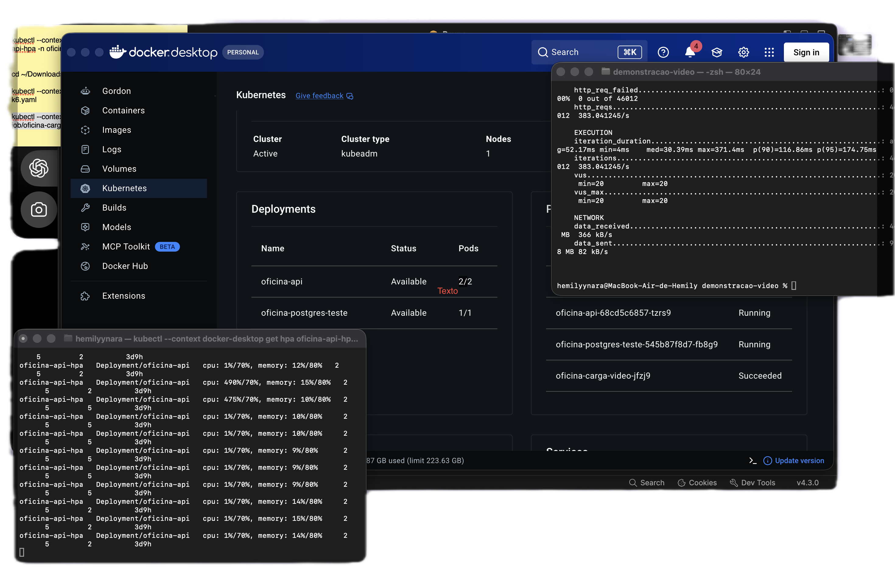

# Kubernetes

A API possui manifestos Kubernetes para criação do namespace, gerenciamento dos
pods e acesso interno pelo Service. A aplicação também disponibiliza um endpoint
de prontidão que verifica a conexão com o PostgreSQL.

Os arquivos agora estao separados por ambiente; veja [a organizacao Kubernetes](../k8s/README.md).
A base compartilha API e configuracoes. `k8s/local` inclui a configuracao local;
`k8s/aws` reutiliza a API com imagem ECR, sem instalar PostgreSQL no cluster nem
sobrescrever o ConfigMap do RDS. Namespace e Secret sao gerenciados pelo Terraform
nos dois ambientes; o banco local tambem. Os exemplos manuais de namespace e
Secret abaixo sao uma alternativa sem Terraform, nao uma etapa adicional.

## 1. Recursos implementados

| Arquivo | Recurso | Nome | Namespace |
| --- | --- | --- | --- |
| `k8s/local/namespace.yaml` | Namespace | `oficina` | — |
| `k8s/base/api/deployment.yaml` | Deployment | `oficina-api` | `oficina` |
| `k8s/base/api/service.yaml` | Service | `oficina-api` | `oficina` |
| `k8s/base/config/configmap.yaml` | ConfigMap | `oficina-api-config` | `oficina` |
| `k8s/local/secret.yaml.example` | Secret (exemplo) | `oficina-api-secret` | `oficina` |
| `k8s/base/api/hpa.yaml` | HorizontalPodAutoscaler | `oficina-api-hpa` | `oficina` |

O label `app: oficina-api` identifica os pods e é utilizado pelos selectors do
Deployment e do Service. O container da aplicação se chama `api`.

## 2. Deployment

O Deployment executa a imagem `oficina-api:local`, com `imagePullPolicy: IfNotPresent`.
A API escuta na porta `8080`, identificada no manifesto pelo nome `http`.
O token da ServiceAccount não é montado no pod, pois a aplicação não precisa
acessar a API do Kubernetes.

### Configuração da aplicação

As variáveis de ambiente são carregadas por `envFrom`, a partir destes recursos
no namespace `oficina`:

- ConfigMap `oficina-api-config`;
- Secret `oficina-api-secret`.

Esses recursos precisam existir para o container iniciar. A conexão utiliza
`DB_HOST`, `DB_PORT`, `DB_NAME`, `DB_USER` e `DB_PASSWORD`, ou `DATABASE_URL`,
quando definida. A autenticação utiliza `JWT_SECRET`.
O endereço do banco deve ser acessível a partir do pod; `localhost` se refere
ao próprio pod.

### Recursos computacionais

| Recurso | Request | Limit |
| --- | --- | --- |
| CPU | `100m` | `500m` |
| Memória | `128Mi` | `256Mi` |

`spec.replicas` não está definido no manifesto. Na criação sem controlador de
escala, o Deployment utiliza o padrão de uma réplica. O manifesto não impõe uma
quantidade fixa a cada aplicação.

### Verificações de saúde

| Probe | Endpoint | Intervalo | Timeout | Falhas consecutivas |
| --- | --- | --- | --- | --- |
| Startup | `/health` | 2 s | 2 s | 30 |
| Liveness | `/health` | 10 s | 2 s | 3 |
| Readiness | `/ready` | 5 s | 2 s | 3 |

`GET /health` retorna HTTP `200` com `{"status":"ok"}` quando o servidor HTTP
responde. Esse endpoint não consulta o banco.

`GET /ready` executa `Ping` no PostgreSQL com timeout de um segundo:

- HTTP `200` com `{"status":"ready"}` quando a conexão está disponível;
- HTTP `503` com `{"status":"not_ready"}` quando a verificação falha.

A resposta não expõe detalhes da conexão. O contexto da requisição é respeitado.
Uma falha de readiness retira o pod do tráfego normal do Service sem acionar a
liveness por indisponibilidade do banco. O Ping verifica conectividade; não
valida o schema nem substitui a execução das migrations.

### Estratégia de atualização

O Deployment utiliza `RollingUpdate`, com:

| Parâmetro | Valor |
| --- | --- |
| `maxUnavailable` | `0` |
| `maxSurge` | `1` |
| `minReadySeconds` | `5` |
| `progressDeadlineSeconds` | `300` |
| `revisionHistoryLimit` | `3` |

A atualização permite um pod adicional e aguarda a disponibilidade das novas
réplicas antes de reduzir as anteriores. O histórico permite consultar revisões
e executar rollback.

### Encerramento da API e notificações

Ao receber `SIGTERM` ou `SIGINT`, a API passa a responder `503` em `/ready`,
interrompe o consumidor de notificações e mantém o HTTP disponível por cinco
segundos para propagação da retirada do pod. Depois, aguarda até 20 segundos
pelas requisições em andamento. Ao atingir o prazo, fecha as conexões restantes.
O Deployment define `terminationGracePeriodSeconds: 30`. Encerramentos forçados
não permitem essa espera.

Cada notificação é reservada com `FOR UPDATE SKIP LOCKED`, em uma transação que
permanece aberta até o envio e a gravação do resultado. Assim, consumidores de
réplicas diferentes não enviam simultaneamente a mesma mensagem. Falhas voltam
para uma rodada posterior; cancelamentos desfazem a transação e liberam a reserva.
O envio tem timeout de dez segundos e a transação, de 15 segundos, mantendo uma
conexão do pool ocupada durante esse período. Não há alteração de schema.

O Resend recebe uma chave de idempotência derivada do ID da notificação para
reutilização nas tentativas. O SMTP respeita cancelamento e timeout, mas não
oferece idempotência: uma queda depois da aceitação pelo servidor e antes do
commit ainda pode causar reenvio. A reserva evita a concorrência entre réplicas;
ela não garante entrega exatamente uma vez em qualquer falha.

## 3. Service

O Service é do tipo `ClusterIP` e seleciona os pods com `app: oficina-api`.

| Campo | Valor |
| --- | --- |
| Protocolo | `TCP` |
| Porta do Service | `80` |
| `targetPort` | `http` — porta `8080` do container |
| DNS interno | `oficina-api.oficina.svc.cluster.local` |

O endereço do Service permanece estável quando o Deployment substitui os pods.

## 4. ConfigMaps e Secrets

As variáveis são separadas pela sensibilidade: o ConfigMap guarda o que pode ser
versionado e o Secret guarda credenciais. Os nomes das chaves são os lidos pelo
código; renomear uma chave no manifesto não altera o nome lido pela aplicação.
Não repetir a mesma chave nos dois recursos.

### ConfigMap `oficina-api-config`

Versionado em `k8s/base/config/configmap.yaml`. Todos os valores são strings.

| Variável | Finalidade | Valor versionado |
| --- | --- | --- |
| `DB_HOST` | Host do PostgreSQL visto pelo pod | `postgres` |
| `DB_PORT` | Porta do PostgreSQL | `5432` |
| `DB_NAME` | Banco utilizado | `oficina` |
| `SMTP_HOST` | Servidor SMTP; vazio desliga o canal | vazio |
| `SMTP_PORT` | Porta SMTP | `1025` |
| `SMTP_USUARIO` | Usuário SMTP, quando exigido | vazio |
| `EMAIL_REMETENTE` | Remetente das notificações | `Oficina Mecanica <onboarding@resend.dev>` |
| `NOTIFICACAO_INTERVALO_SEGUNDOS` | Intervalo da fila de notificações | `30` |
| `NOTIFICACAO_LOTE` | Notificações por rodada | `20` |
| `CAPACIDADE_DIARIA_OS` | Capacidade usada na estimativa de entrega | `0` |

`DB_HOST` deve apontar para o Service ou endpoint do banco no ambiente; `postgres`
é o nome de referência. `NOTIFICACAO_INTERVALO_SEGUNDOS` precisa ser positivo:
valores inválidos ou `0` utilizam o padrão de 30 segundos. `CAPACIDADE_DIARIA_OS`
igual a `0` deixa a fila fora da estimativa de entrega.

A porta HTTP é fixa em `:8080` no código e a aplicação não possui nível de log
configurável; por isso essas configurações não fazem parte do ConfigMap.

### Secret `oficina-api-secret`

Somente o exemplo `k8s/local/secret.yaml.example` é versionado, com marcadores no lugar
das credenciais. A extensão `.example` impede que `kubectl apply -f k8s/` aplique
os marcadores sobre o Secret real. O arquivo preenchido `k8s/local/secret.yaml` está
no `.gitignore` e no `.dockerignore`.

| Variável | Obrigatória | Finalidade |
| --- | --- | --- |
| `DB_USER` | Sim, sem `DATABASE_URL` | Usuário do PostgreSQL |
| `DB_PASSWORD` | Sim, sem `DATABASE_URL` | Senha do PostgreSQL |
| `JWT_SECRET` | Sim | Chave de assinatura dos tokens; igual entre réplicas |
| `SMTP_SENHA` | Não | Senha SMTP, quando exigida pelo servidor |
| `RESEND_API_KEY` | Não | Token do Resend; quando preenchido, tem prioridade sobre o SMTP |
| `DATABASE_URL` | Não | Conexão completa; quando preenchida, substitui as variáveis `DB_*` |

A URL de conexao montada com `DB_*` codifica caracteres reservados. Sem DB_SSLMODE,
o comportamento local continua sslmode=disable. Na AWS, Terraform configura
DB_SSLMODE=verify-full e DB_SSLROOTCERT para verificar o certificado do RDS.
DATABASE_URL, quando definida, prevalece e deve incluir sua propria configuracao
TLS. Uma URL com senha nao deve ficar no ConfigMap. SONAR_TOKEN nao e usado pela API.

O canal de notificação segue esta ordem: `RESEND_API_KEY` preenchida usa o
Resend; sem ela, `SMTP_HOST` preenchido usa SMTP; sem os dois, as notificações
vão apenas para o log.

### Criação do Secret

Somente na alternativa local sem Terraform, copiar o exemplo, preencher os marcadores
e aplicar (com Terraform, usar o Secret que ele ja provisionou):

```bash
cp k8s/local/secret.yaml.example k8s/local/secret.yaml
kubectl --context kind-oficina apply -f k8s/local/secret.yaml
```

O Secret da aplicação é aplicado no cluster de destino antes do Deployment.
O workflow de publicação da imagem não cria nem modifica esse recurso.
Os valores utilizados em execução pertencem ao ambiente de destino.

Base64 não é criptografia: a proteção do Secret depende das permissões do cluster.

### Atualização da configuração

Na alternativa manual local, as variáveis são injetadas por `envFrom` na criação do container. Pods em execução
não recebem novos valores; depois de alterar o ConfigMap ou o Secret, recriar os pods:

```bash
kubectl --context kind-oficina apply -k k8s/local
kubectl --context kind-oficina apply -f k8s/local/secret.yaml
kubectl --context kind-oficina -n oficina rollout restart deployment/oficina-api
kubectl -n oficina rollout status deployment/oficina-api --timeout=300s
```

O `rollout undo` reverte o template dos pods, mas não restaura valores anteriores
do ConfigMap ou do Secret. Alterar `JWT_SECRET` invalida os tokens já emitidos.
Se um valor novo impedir a conexão com o banco, o pod novo não fica pronto e,
com `maxUnavailable: 0`, os pods anteriores continuam atendendo.

## 5. Horizontal Pod Autoscaler (HPA)

Para o ambiente Kind provisionado com Terraform, siga o
[guia de infraestrutura local](../infra/README.md), com Metrics Server fixado e
armazenamento persistente. Nesse fluxo, namespace, Secret e banco sao geridos
somente pelo Terraform; nao reaplique esses recursos pelos comandos deste documento.

O manifesto `k8s/base/api/hpa.yaml` utiliza `autoscaling/v2` e controla o Deployment
`oficina-api` no namespace `oficina`.

| Configuração | Valor |
| --- | --- |
| Réplicas mínimas | `2` |
| Réplicas máximas | `5` |
| Meta de CPU | `70%` do request |
| Meta de memória | `80%` do request |
| Janela de estabilização da redução | `300` segundos |

Com os requests do Deployment, as metas correspondem a aproximadamente `70m`
de CPU e `102,4Mi` de memória por pod. As metas utilizam os requests, não os limits.
O controlador calcula a quantidade de réplicas para cada métrica e utiliza a maior.

O HPA controla `spec.replicas`; esse campo é omitido no manifesto do Deployment.
Reaplicar o Deployment preserva a quantidade administrada pelo HPA. Durante
RollingUpdate, `maxSurge: 1` permite um pod adicional ao número desejado.

### Disponibilidade das métricas

O cluster precisa disponibilizar a API de métricas por meio do metrics-server.
No ambiente de destino, verificar se esse componente já é gerenciado pelo provedor
antes de instalar uma segunda instância.

```bash
kubectl get apiservice v1beta1.metrics.k8s.io
kubectl top pods -n oficina
```

Na validação local, foi utilizado metrics-server `v0.9.0`:

```bash
kubectl apply -f https://github.com/kubernetes-sigs/metrics-server/releases/download/v0.9.0/components.yaml
```

No Docker Desktop utilizado nos testes, a validação do certificado do kubelet
exigiu a configuração abaixo, exclusiva desse ambiente local:

```bash
kubectl -n kube-system patch deployment metrics-server --type=json \
  -p='[{"op":"add","path":"/spec/template/spec/containers/0/args/-","value":"--kubelet-insecure-tls"}]'
kubectl -n kube-system rollout status deployment/metrics-server --timeout=120s
```

Essa opção desabilita a verificação TLS do kubelet; no ambiente de destino,
utilizar certificados confiáveis e a configuração suportada pelo provedor.

### Aplicação e acompanhamento

Depois de criar o namespace, as configurações, o Deployment e o Service:

```bash
kubectl apply -f k8s/base/api/hpa.yaml
kubectl -n oficina get hpa oficina-api-hpa
kubectl -n oficina describe hpa oficina-api-hpa
kubectl -n oficina top pods -l app=oficina-api
```

A primeira coleta de métricas pode levar alguns instantes. Durante inicialização
ou substituição dos pods, valores `<unknown>` podem ser transitórios. A condição
`ScalingActive: True` confirma que o controlador encontrou uma métrica válida.
Em caso de ausência persistente, verificar o metrics-server, os requests e a
prontidão dos pods.

### Teste de carga reproduzível com k6

O arquivo [k8s/tests/carga-k6.yaml](../k8s/tests/carga-k6.yaml) cria um ConfigMap
com o script e um Job que executa o k6 dentro do cluster. O gerador acessa a API
pelo DNS do Service, sem depender de Bruno, port-forward ou instalação local do k6.

Executar em ambiente de teste, com a API, PostgreSQL, migrations e seed preparados.
O manifesto utiliza o namespace `oficina`, Service `oficina-api` e o usuário de
desenvolvimento `mecanico@oficina.local`, com senha `mecanico123`. Em outro ambiente,
ajustar namespace, endereço do Service e credenciais de teste no manifesto.
O HPA e a API de métricas precisam estar ativos para acompanhar a escala.

| Parâmetro | Configuração |
| --- | --- |
| Endpoint | `POST /autenticacao/login` |
| Usuários virtuais simultâneos | `20` |
| Duração da carga | `120s` |
| Verificações por requisição | HTTP `200` e presença de `accessToken` como string |
| Critérios de aprovação | Zero falhas HTTP e 100% das verificações aprovadas |
| Repetição automática do Job | Desativada (`backoffLimit: 0`) |
| Remoção automática do Job concluído | Após `900s` |

A carga autentica o usuário de teste repetidamente, sem criar clientes ou OS.
Cada usuário virtual executa novas requisições enquanto o teste está ativo;
vinte usuários virtuais não limitam o total a vinte requisições.
O label do gerador é diferente de `app: oficina-api`, mantendo a carga fora dos
selectors do Service da API e dos pods monitorados pelo HPA.

Os comandos abaixo utilizam o contexto local `docker-desktop` e devem ser
executados na raiz do repositório. Para outro cluster, selecionar o contexto
correspondente antes da execução.

Em um terminal, acompanhar o HPA:

```bash
kubectl --context docker-desktop get hpa oficina-api-hpa -n oficina --watch
```

Em outro terminal, iniciar a carga e acompanhar seu resultado:

```bash
kubectl --context docker-desktop apply -f k8s/tests/carga-k6.yaml
kubectl --context docker-desktop logs -f -n oficina \
  job/oficina-carga-video --pod-running-timeout=90s
```

A criação de novos pods também pode ser acompanhada no Docker Desktop, em
**Kubernetes → Namespace → oficina**, ou pelo terminal:

```bash
kubectl --context docker-desktop get pods -n oficina -l app=oficina-api --watch
kubectl --context docker-desktop top pods -n oficina
```

O comando com `--watch` permanece aberto até `Control + C`; executar `top` em
outra aba ou após encerrar o acompanhamento. Isso não interrompe a aplicação.

Observar a expansão com o aumento de consumo e a redução depois da carga.
A janela de estabilização de `300s` considera recomendações recentes do HPA;
a volta a duas réplicas pode levar mais de cinco minutos após o teste.
O pico de réplicas e a quantidade de requisições dependem da carga, das métricas
e dos recursos disponíveis no cluster.

O resumo do k6 apresenta `vus` (usuários virtuais), `http_reqs` (requisições),
`http_req_failed` (falhas), `checks` (verificações) e `http_req_duration` (latência).
Como existem duas verificações por requisição, a contagem de checks é o dobro
da quantidade de requisições nesse cenário.

Para repetir antes da remoção automática, excluir somente o Job anterior e
aplicar novamente:

```bash
kubectl --context docker-desktop delete job oficina-carga-video -n oficina --ignore-not-found
kubectl --context docker-desktop apply -f k8s/tests/carga-k6.yaml
```

Depois de salvar os resultados, remover somente os recursos de carga:

```bash
kubectl --context docker-desktop delete job oficina-carga-video -n oficina --ignore-not-found
kubectl --context docker-desktop delete configmap oficina-carga-video-script -n oficina --ignore-not-found
```

Esses comandos preservam o Deployment, o HPA, o Service e o PostgreSQL.

Referências: [HPA](https://kubernetes.io/docs/concepts/workloads/autoscaling/horizontal-pod-autoscale/)
e [metrics-server v0.9.0](https://github.com/kubernetes-sigs/metrics-server/releases/tag/v0.9.0).

## 6. Execução

### Pré-requisitos

- Docker e cluster Kubernetes disponíveis;
- `kubectl` configurado para o cluster correto;
- imagem acessível pelo runtime do cluster;
- namespace, Secret e banco provisionados pelo Terraform do ambiente (ou alternativa manual da secao 4);
- PostgreSQL acessível, com as migrations aplicadas;
- API de métricas disponível para o HPA.

Executar os comandos a partir da raiz do repositório.

### Construção da imagem

```bash
docker build -t oficina-api:local .
```

Em clusters com runtime separado do Docker local, carregar a imagem ou utilizar
uma imagem publicada em registry acessível. Para Kind e Minikube, respectivamente:

```bash
kind load docker-image oficina-api:local --name NOME_DO_CLUSTER
minikube image load oficina-api:local
```

Executar somente o comando correspondente ao ambiente utilizado.

### Aplicação dos manifestos

```bash
kubectl config current-context
kubectl kustomize k8s/local
kubectl --context kind-oficina apply -k k8s/local
kubectl --context kind-oficina -n oficina get configmap oficina-api-config
kubectl --context kind-oficina -n oficina get secret oficina-api-secret
kubectl --context kind-oficina -n oficina rollout status deployment/oficina-api --timeout=300s
kubectl --context kind-oficina -n oficina get hpa oficina-api-hpa
```

A consulta ao Secret acima exibe metadados, sem imprimir os valores. Namespace,
Secret e banco devem existir antes desse deploy. Para AWS, usar o overlay k8s/aws
depois de selecionar a imagem ECR; nao aplicar o overlay local no EKS.

### Acesso local

```bash
kubectl -n oficina port-forward service/oficina-api 8080:80
```

Em outro terminal:

```bash
curl --fail http://localhost:8080/health
curl --fail http://localhost:8080/ready
```

O acesso por port-forward depende da permanência desse processo. Se o pod
selecionado for substituído, pode ser necessário executar o comando novamente.

### Atualização e rollback

Substituir `NOVA_IMAGEM:TAG` por uma imagem disponível no cluster:

```bash
kubectl -n oficina set image deployment/oficina-api api=NOVA_IMAGEM:TAG
kubectl -n oficina rollout status deployment/oficina-api --timeout=300s
kubectl -n oficina rollout history deployment/oficina-api
kubectl -n oficina rollout undo deployment/oficina-api
kubectl -n oficina rollout status deployment/oficina-api --timeout=300s
```

O rollback exige uma revisão anterior. Atualizar também a referência da imagem no
manifesto antes de reaplicá-lo, para manter a configuração declarada consistente.
Variáveis injetadas por `envFrom` são recarregadas quando os pods são recriados:

```bash
kubectl -n oficina rollout restart deployment/oficina-api
```

## 7. Verificação e diagnóstico

```bash
kubectl -n oficina get pods -l app=oficina-api
kubectl -n oficina get service oficina-api
kubectl -n oficina get endpointslices -l kubernetes.io/service-name=oficina-api
kubectl -n oficina describe deployment oficina-api
kubectl -n oficina logs deployment/oficina-api --tail=100
kubectl -n oficina get events --sort-by=.metadata.creationTimestamp
```

Para observar a substituição de um pod no ambiente de teste:

```bash
kubectl -n oficina delete pod NOME_DO_POD
kubectl -n oficina get pods -l app=oficina-api -w
```

Com apenas uma réplica, a exclusão pode causar indisponibilidade temporária até
o substituto ficar pronto.

## 8. Validações executadas

- Manifestos validados por schema e por dry-run no servidor Kubernetes.
- Testes automatizados de `/ready`: banco disponível, indisponível e contexto cancelado.
- API executada no Kubernetes local com acesso pelo DNS do Service e por port-forward.
- Login e consulta autenticada ao banco com dados de teste.
- Exclusão de pod e criação automática de substituto pronto para receber tráfego.
- Atualização para imagem distinta, identificada na resposta de saúde, e rollback
  para a imagem original.
- Amostra local de 435 chamadas curtas pelo Service durante as trocas, todas com
  resposta HTTP `200`; esse resultado não representa garantia geral de disponibilidade.
- ConfigMap e Secret aplicados em cluster Kind com o Deployment: API pronta,
  `/ready` com o banco, login e consulta autenticada com o `JWT_SECRET` do Secret.
- `SMTP_HOST` alterado no ConfigMap: o pod em execução manteve o valor anterior e,
  após `rollout restart`, a notificação de diagnóstico chegou ao Mailpit.
- Senha incorreta no Secret: o pod novo não ficou pronto e o anterior continuou
  atendendo.
- Nenhum valor do Secret encontrado nos logs da API, nos eventos do namespace ou
  no `describe` do Deployment.


### Evidências da validação integrada

Em 23/10/2026, Deployment, Service, ConfigMap, Secret e HPA foram executados em
namespace isolado no Docker Desktop, com Kubernetes `v1.36.1`, metrics-server
`v0.9.0` e PostgreSQL 16 com as 22 migrations e o seed do projeto:

- Escala automática de `2 → 5 → 2` réplicas, com redução final aproximadamente
  346 segundos após o encerramento observado da carga.
- 48.263 logins válidos no teste com k6, sem falhas; p95 de 159,7 ms.
- 12.939 chamadas leves durante escala, recuperação, atualização e rollback,
  todas com HTTP `200` na amostra observada.
- ConfigMap e Secret recarregados após rollout; pods existentes mantiveram o
  ambiente anterior até sua substituição.
- Recuperação de pod e preservação do tráfego diante de réplica não pronta.
- Reaplicação do Deployment preservou as réplicas definidas pelo HPA.
- Requisição em andamento no pod excluído concluiu com HTTP `200` em 10,94 segundos.
- Cem notificações processadas por cinco réplicas, com uma tentativa por mensagem
  e sem duplicidade nos logs; nenhum envio externo de e-mail.

A escala por memória foi verificada separadamente em cenário controlado, com
meta temporária de `1%` e sem a métrica de CPU; o controlador expandiu para cinco
réplicas. As metas originais de CPU `70%` e memória `80%` foram restauradas.
Esse cenário valida a decisão por memória e não representa carga de memória
no limite de operação. Os resultados locais não constituem garantia geral de
capacidade ou de disponibilidade em outro ambiente.


### Teste de carga demonstrado em 27/10/2026

A demonstração foi executada no Kubernetes local do Docker Desktop, namespace
`oficina`, com o HPA da PR #72 e a imagem
`oficina-api:clean-architecture-contratos-local`, validada na PR #74.
O vídeo registrou a expansão para cinco pods; o print abaixo registra o resumo
da carga e o histórico com a redução automática para dois.

| Indicador | Resultado observado |
| --- | --- |
| Usuários virtuais (`vus`) | `20`, mantidos durante a carga |
| Duração configurada | `120s` |
| Requisições HTTP (`http_reqs`) | `46.012` |
| Taxa média de requisições | Aproximadamente `383/s` |
| Falhas HTTP (`http_req_failed`) | `0`, em `46.012` requisições |
| Verificações aprovadas (`checks_succeeded`) | `92.024`, correspondentes a 100% |
| Latência média HTTP | `52 ms` |
| Percentil 95 da latência HTTP | `174,61 ms` |
| Escala observada | `2 → 5 → 2` réplicas |

As `92.024` verificações correspondem a `46.012 × 2`: status HTTP `200` e retorno
de token. O total de checks não representa requisições adicionais.
O p95 indica que 95% das requisições tiveram duração até `174,61 ms` nessa amostra.

No histórico do HPA, a CPU passou de aproximadamente `1%` para `490%` do request,
acima da meta de `70%`, e o controlador ampliou o Deployment para cinco réplicas.
Depois da carga, a CPU retornou a aproximadamente `1%`; as cinco réplicas foram
mantidas durante a estabilização e, em seguida, reduzidas automaticamente para
duas. O percentual de CPU é calculado em relação ao request dos pods, não à
capacidade total da máquina.



A evidência corresponde à execução local de 27/10/2026. Esses números descrevem
a amostra observada e não representam uma garantia de capacidade em outro ambiente.


## 9. Imagem no Amazon ECR

O workflow `.github/workflows/docker-build-push.yml` e acionado manualmente e publica
no ECR `oficina-mecanica`, em `us-east-1`, depois de conferir sucesso de Build e
Validate deployment no SHA selecionado. PRs, push e acionamentos de Build nao publicam.

O checkout e a tag utilizam o mesmo SHA completo aprovado pelo CI:

```text
CONTA.dkr.ecr.us-east-1.amazonaws.com/oficina-mecanica:COMMIT_COMPLETO
```

O repositorio ECR deve existir. Os Secrets do GitHub `AWS_ACCESS_KEY_ID`,
`AWS_SECRET_ACCESS_KEY` e `AWS_SESSION_TOKEN` precisam conter as credenciais
validas da sessao Academy. A publicacao real ainda precisa ser validada.

O workflow publica API e Flyway e executa migrations e deploy no EKS depois da
publicacao, usando o mesmo SHA, somente por acionamento manual com CI aprovado.
Ver [guia de deploy](06-deploy-eks.md). As maquinas EKS ja
possuem permissao de leitura ECR; acesso do runner ao EKS, credenciais e execucao
real ainda precisam ser validados antes de considerar o deploy comprovado.

Depois que a API estiver instalada no EKS, uma atualizacao da imagem seria:

```bash
kubectl --context oficina-aws -n oficina set image deployment/oficina-api \
  api=CONTA.dkr.ecr.us-east-1.amazonaws.com/oficina-mecanica:COMMIT_COMPLETO
kubectl --context oficina-aws -n oficina rollout status deployment/oficina-api --timeout=300s
```

Substituir CONTA e COMMIT_COMPLETO pelos valores da publicacao. A configuracao
declarativa do deploy tambem precisa usar essa imagem, para nao voltar a tag local
quando os manifestos forem reaplicados. Terraform, migrations e HPA continuam
necessarios; trocar o registry nao muda suas responsabilidades.
