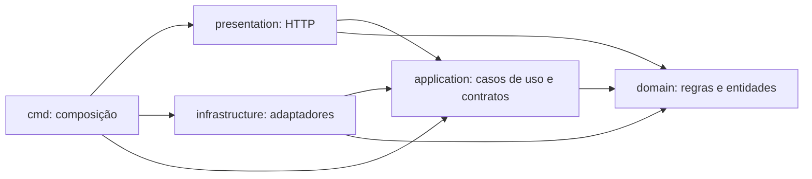

# Clean Architecture

A aplicação utiliza Clean Architecture para separar os casos de uso e as regras
de negócio dos detalhes de HTTP, persistência e serviços externos. A organização
por contextos de negócio é mantida dentro das camadas do monólito.

## 1. Responsabilidades e dependências

| Diretório | Responsabilidade |
| --- | --- |
| `internal/domain` | Entidades, valores, regras e erros de negócio |
| `internal/application` | Casos de uso e contratos de saída consumidos por eles |
| `internal/presentation` | Adaptadores HTTP, autenticação das requisições e conversão de dados de entrada/saída |
| `internal/infrastructure` | Adaptadores de PostgreSQL, JWT, bcrypt e envio de notificações |
| `cmd/oficina-mecanica` | Composição das dependências, registro de rotas e inicialização do servidor |

As setas abaixo representam dependências de código, não a ordem das chamadas:



Os casos de uso conhecem os contratos necessários para executar suas operações.
As implementações concretas são fornecidas pela composição em `routes.go`.
A aplicação não importa os adaptadores para instanciá-los.

O pacote `shared/validation` contém validações de valores independentes de
persistência e HTTP. A interpretação de sintaxe de e-mail utiliza `net/mail`,
sem realizar conexão ou envio. Os recursos `shared/http` e `shared/database`
pertencem às bordas técnicas da aplicação.

## 2. Contratos de persistência por caso de uso

Os casos de uso recebem contratos de persistência definidos na aplicação, com as
operações necessárias ao seu trabalho. Esse padrão é aplicado a clientes,
veículos, mecânicos, fornecedores, serviços, OS, orçamentos, peças, insumos,
estoque, autenticação e notificações.

Os contratos compartilhados foram segregados para cadastro e atualização de
mecânico; listagem, busca e alteração de situação de fornecedor; desativação e
reativação de serviço; consulta individual e listagem de tempos de execução de OS.
Os demais contratos específicos já existentes foram preservados. As transações,
consultas SQL e bloqueios permanecem nos adaptadores PostgreSQL.

Por exemplo, a consulta de cliente depende de uma única operação:

```go
type ConsultarRepository interface {
    BuscarPorDocumento(context.Context, string) (domain.Cliente, error)
}
```

O caso de uso realiza a normalização/validação do documento e chama esse contrato.
`PostgresRepository` implementa a persistência utilizando pgx. O contrato não
expõe conexão, transação, linhas SQL ou tipos do driver.

As declarações de conformidade nos adaptadores verificam as implementações em
tempo de compilação:

```go
var _ application.ConsultarRepository = PostgresRepository{}
```

Referências:

- [Contratos de cliente](../internal/application/cliente/ports.go).
- [Contratos de veículo](../internal/application/veiculo/ports.go).
- [Conformidade do adaptador de cliente](../internal/infrastructure/cliente/contracts.go).
- [Conformidade do adaptador de veículo](../internal/infrastructure/veiculo/contracts.go).
- [Contratos de mecânico](../internal/application/mecanico/ports.go).
- [Contratos de fornecedor](../internal/application/fornecedor/ports.go).
- [Contratos de serviço](../internal/application/servico/ports.go).
- [Contratos de tempo de execução](../internal/application/ordemservico/ports.go).

Todos os adaptadores PostgreSQL possuem declarações de conformidade em seus
arquivos `contracts.go`.

## 3. Contratos de entrada HTTP

Todos os 56 construtores de handlers recebem interfaces locais dos casos de uso.
O padrão abrange clientes, veículos, mecânicos, fornecedores, serviços, OS,
orçamentos, peças, insumos, estoque e login. Os contratos descrevem `Execute` ou
as operações de consulta necessárias. O adaptador HTTP pode receber a
implementação real ou um substituto de teste que cumpra o mesmo contrato.

Um teste de arquitetura inspeciona os construtores e rejeita a volta de parâmetros
com casos de uso concretos. Essa proteção foi validada com um handler temporário
inválido, rejeitado pelo teste e removido após a verificação.

A apresentação interpreta caminhos, cabeçalhos, parâmetros e JSON, chama o caso
de uso e converte o resultado ou erro em uma resposta HTTP. Os nomes dos endpoints,
as permissões, os corpos JSON e os códigos de resposta foram preservados.

Referências:

- [Contratos de entrada de veículo](../internal/presentation/veiculo/usecases.go).
- [Contratos de entrada de OS](../internal/presentation/ordemservico/usecases.go).
- [Contratos de entrada de orçamento](../internal/presentation/orcamento/usecases.go).
- [Verificação dos construtores HTTP](../tests/architecture/handlers_test.go).

## 4. Algoritmo de senha como adaptador

Autenticação e cadastro de mecânico dependem de contratos definidos pelos seus
consumidores:

| Caso de uso | Contrato | Operação |
| --- | --- | --- |
| `Autenticar` | `VerificadorSenha` | `Verificar(hash, senha string) error` |
| `Cadastrar` de mecânico | `GeradorHashSenha` | `Gerar(senha string) (string, error)` |

O adaptador [Bcrypt](../internal/infrastructure/seguranca/bcrypt.go) implementa
ambos. A montagem das rotas injeta esse adaptador nos casos de uso.
O algoritmo, o custo padrão, a compatibilidade com hashes existentes e o tratamento
de senha incorreta foram mantidos.

Os casos de uso não importam `golang.org/x/crypto/bcrypt`. Seus testes unitários
utilizam implementações substitutas dos contratos; os testes do adaptador e de
integração verificam o bcrypt real e a autenticação com PostgreSQL.

## 5. Regras de execução e entrega no domínio

As decisões de autorização para iniciar a execução e de existência de orçamento
aprovado para entrega são implementadas no domínio de OS:

- `ValidarAutorizacaoParaExecucao`: exige orçamento aprovado e serviços autorizados,
  preservando a prioridade dos erros de negócio.
- `ValidarRecursosParaExecucao`: bloqueia recursos necessários sem reserva ativa.
- `ValidarOrcamentosParaEntrega`: exige orçamento aprovado para o valor final.

O adaptador lê os dados necessários e invoca essas regras dentro da transação
existente, antes das gravações correspondentes. As consultas SQL, os locks,
a auditoria e os commits permanecem na infraestrutura, com a ordem das operações
preservada. Essas regras são testáveis sem banco ou servidor HTTP.

Referências: [execução](../internal/domain/ordemservico/iniciar_execucao.go)
e [entrega](../internal/domain/ordemservico/entregar.go).

## 6. Verificação automática da arquitetura

O teste [dependencies_test.go](../tests/architecture/dependencies_test.go) examina
os imports dos arquivos Go de produção nas camadas. Ele impede:

- Domínio dependente de aplicação, apresentação, infraestrutura ou drivers.
- Casos de uso dependentes de HTTP, banco, adaptadores ou bibliotecas externas.
- Apresentação acessando infraestrutura ou drivers de banco diretamente.
- Infraestrutura dependente da apresentação.
- Validações compartilhadas dependentes das camadas da aplicação.

O teste não precisa inicializar banco ou servidor e roda na suíte `go test ./...`
da pipeline. As declarações de conformidade complementam essa verificação,
impedindo que um adaptador deixe de implementar o contrato consumido.

```bash
go test -v ./tests/architecture
go test ./internal/domain/... ./internal/application/...
```

Para a validação completa, utilizar PostgreSQL de testes com migrations e seed
aplicados e `DATABASE_URL` configurada:

```bash
go test -count=1 -race ./...
go vet ./...
```

A verificação de dependências foi exercitada também com imports proibidos
introduzidos temporariamente em domínio, aplicação, apresentação e infraestrutura:
os quatro cenários foram rejeitados e os arquivos de prova removidos.


## 7. Validação da implementação

| Verificação | Resultado |
| --- | --- |
| Suíte completa sem cache, com detector de concorrência | 65 pacotes aprovados, nenhum teste pulado |
| Cobertura das camadas internas | 84,4% |
| Análise estática com `go vet` | Aprovada |
| Construtores HTTP protegidos pelo teste de arquitetura | 56 |
| Comparação HTTP antes/depois da extensão dos contratos | 804 requisições e 38 verificações SQL |
| Rotas com resposta de sucesso | 58 de 58 nas duas versões |
| Respostas sequenciais comparadas | 142 equivalentes por versão |
| Teste direto no PostgreSQL original | 53 requisições HTTP e 6 verificações SQL |
| Preservação dos registros anteriores no banco original | 24 tabelas conferidas por contagem e checksum |

A suíte completa utiliza PostgreSQL isolado com migrations e seed aplicados. A
comparação HTTP utiliza duas cópias dos dados persistentes, atualizadas com as
migrations necessárias apenas nas cópias. UUIDs, horários e JWTs gerados são
normalizados; os itens de orçamento são comparados por conteúdo, pois as consultas
existentes os ordenam por IDs aleatórios. As demais listas mantêm sua ordem.

A regressão abrange autenticação, permissões, cadastros, estoque, orçamentos e
fluxos de OS, além de concorrência, versionamento, rollback e idempotência.
Cenários específicos utilizam precondições preparadas por SQL nos bancos de teste.
O envio externo de e-mail não faz parte dessa validação.

No banco original, os testes criaram registros exclusivos, exercitaram consultas,
atualizações, inativação e reativação, e removeram somente os registros criados.
Nenhuma migration ou alteração de permissões foi aplicada ao banco original.
As operações adicionais usaram um token exclusivo da API temporária de validação.


### Validação integrada no Kubernetes local

A imagem com os contratos foi validada em namespace isolado no Docker Desktop,
com Deployment, Service, ConfigMap, Secret, PostgreSQL e HPA. As 58 rotas tiveram
resposta de sucesso em 402 requisições e 19 verificações SQL. O HPA escalou
automaticamente de duas para cinco réplicas e retornou a duas; 42.513 logins da
carga responderam 200. Recarga de configurações, exclusão/substituição de pod,
RollingUpdate, rollback e conclusão de uma requisição em andamento foram
verificados.

Durante uma redução controlada adicional, 2.548 consultas de cliente e 2.550
chamadas a `/health` responderam 200. A probe `/ready` sinalizou 503 em pods em
processo de desligamento, conforme o ciclo de vida implementado. O lote de cem
notificações foi processado uma vez por notificação usando envio para log.

As metas temporárias usadas nos controles foram restauradas. O namespace de
testes foi removido; o namespace habitual e o banco original permaneceram
preservados. A publicação e o deploy pela pipeline remota não fazem parte desta
validação local.
