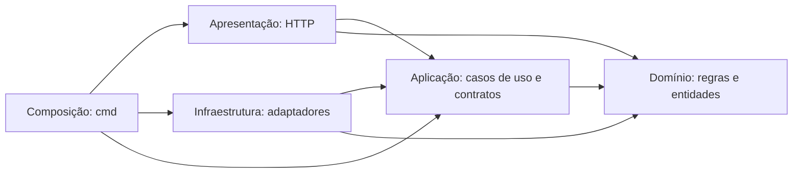

# Clean Architecture

A aplicação organiza regras de negócio, casos de uso e adaptadores em camadas
com dependências explícitas. O núcleo define os contratos que consome; a
composição da aplicação fornece as implementações de HTTP, PostgreSQL,
autenticação, senhas e notificações.

O projeto mantém a estrutura de monólito, com os contextos de negócio agrupados
dentro das camadas: clientes, veículos, mecânicos, fornecedores, serviços,
ordens de serviço, orçamentos, peças, insumos, estoque, segurança e notificações.

## 1. Organização das camadas

| Diretório | Responsabilidade | Exemplos implementados |
| --- | --- | --- |
| `internal/domain` | Entidades, valores, validações e regras de negócio | Cadastro de cliente e veículo; condições de execução e entrega de OS |
| `internal/application` | Casos de uso, coordenação das operações e contratos consumidos pelo núcleo | Cadastrar, consultar, atualizar, inativar, reativar, autenticar e executar OS |
| `internal/presentation` | Adaptação HTTP e conversão entre requisições, casos de uso e respostas | Handlers, structs de entrada/saída, leitura de cabeçalhos e tratamento de erros |
| `internal/infrastructure` | Implementação dos contratos e integração com recursos técnicos | Repositórios PostgreSQL, bcrypt, JWT e adaptadores de envio de notificações |
| `cmd/oficina-mecanica` | Composição das dependências e inicialização | Criação de adaptadores, injeção nos casos de uso, registro de rotas e servidor |

As setas representam dependências de código:



A aplicação conhece as interfaces de persistência e serviços que utiliza.
Os adaptadores implementam essas interfaces. O domínio contém as decisões de
negócio e utiliza validações de valores independentes de I/O.

O pacote `shared/validation` reúne essas validações; `net/mail` é utilizado para
interpretar sintaxe de e-mail. Os pacotes `shared/http` e `shared/database`
concentram recursos técnicos utilizados nas bordas correspondentes.

## 2. Contratos de persistência por operação

Os contratos de saída são definidos em `internal/application`. Suas assinaturas
utilizam tipos de domínio ou aplicação, `context.Context` e tipos da biblioteca
padrão, mantendo conexões e tipos do driver PostgreSQL na infraestrutura.

A segregação dos contratos está implementada nos seguintes contextos:

| Contexto | Organização dos contratos |
| --- | --- |
| Cliente | Cadastro, consulta, atualização, inativação e reativação |
| Veículo | Cadastro, consulta, atualização, inativação e reativação |
| Mecânico | Cadastro e atualização com operações próprias de persistência |
| Fornecedor | Cadastro, listagem, busca por ID, atualização, desativação e reativação |
| Serviço | Cadastro, consulta, atualização, desativação e reativação |
| OS | Criação, registros, consultas, fila, execução, finalização, entrega e devolução; consulta individual e listagem de tempos separadas |
| Orçamento | Consulta, cálculo, envio, aprovação e recusa |
| Peça e insumo | Cadastro, consulta, desativação, compra/reserva e atualização de peça |
| Estoque | Registro de entrada |
| Segurança | Consulta do usuário para autenticação |
| Notificação | Consulta de contato/enfileiramento e processamento da fila |

Por exemplo, a consulta de cliente depende de uma única operação:

```go
type ConsultarRepository interface {
    BuscarPorDocumento(context.Context, string) (domain.Cliente, error)
}
```

O cadastro utiliza outro contrato:

```go
type CadastrarRepository interface {
    ExisteAtivoPorDocumento(context.Context, string) (bool, error)
    Salvar(context.Context, domain.Cliente) (domain.Cliente, error)
}
```

A consulta normaliza e valida o documento antes de chamar a persistência.
O cadastro constrói o cliente, verifica duplicidade e solicita sua gravação.
Cada operação recebe o contrato correspondente pelo construtor.

Referências: [cliente](../internal/application/cliente/ports.go),
[veículo](../internal/application/veiculo/ports.go),
[mecânico](../internal/application/mecanico/ports.go),
[fornecedor](../internal/application/fornecedor/ports.go),
[serviço](../internal/application/servico/ports.go) e
[tempos de execução de OS](../internal/application/ordemservico/ports.go).

## 3. Adaptadores PostgreSQL e conformidade dos contratos

Os repositórios de `internal/infrastructure` implementam as operações de
persistência. Consultas SQL, bloqueios, auditorias e limites de transação são
mantidos nesses adaptadores. O processamento utiliza os contratos definidos
pela aplicação para acessar essas implementações.

Os 12 adaptadores PostgreSQL possuem declarações de conformidade verificadas
pelo compilador, em seus arquivos `contracts.go`:

```go
var _ application.ConsultarRepository = PostgresRepository{}
```

A declaração verifica que o adaptador fornece os métodos e as assinaturas
exigidos pelo contrato. A compilação da composição das rotas também verifica a
compatibilidade entre os casos de uso e os handlers que os recebem.

Referências: [adaptador de cliente](../internal/infrastructure/cliente/contracts.go),
[adaptador de OS](../internal/infrastructure/ordemservico/contracts.go) e
[adaptador de orçamento](../internal/infrastructure/orcamento/contracts.go).

## 4. Contratos dos handlers HTTP

Os 56 construtores de handlers recebem interfaces locais de casos de uso.
O padrão abrange clientes, veículos, mecânicos, fornecedores, serviços, OS,
orçamentos, peças, insumos, estoque e login.

Exemplo do contrato de autenticação:

```go
type AutenticarUseCase interface {
    Execute(ctx context.Context, email, senha string) (string, error)
}
```

O handler interpreta o JSON da requisição, chama `Execute` e traduz o resultado
para a resposta HTTP. O caso de uso pode ser fornecido pela composição real
ou por uma implementação de teste que atenda à mesma assinatura.

Caminhos, cabeçalhos, filtros, autenticação da requisição e serialização JSON
são tratados na apresentação e nos helpers HTTP. As regras e a coordenação da
operação permanecem nos respectivos casos de uso e no domínio.

Referências: [login](../internal/presentation/seguranca/usecases.go),
[veículos](../internal/presentation/veiculo/usecases.go),
[OS](../internal/presentation/ordemservico/usecases.go),
[orçamentos](../internal/presentation/orcamento/usecases.go) e
[estoque](../internal/presentation/estoque/usecases.go).

## 5. Serviços técnicos recebidos por contrato

### Geração e verificação de senha

Autenticação e cadastro de mecânico recebem contratos próprios de senha:

| Caso de uso | Contrato | Operação |
| --- | --- | --- |
| `Autenticar` | `VerificadorSenha` | `Verificar(hash, senha string) error` |
| `Cadastrar` de mecânico | `GeradorHashSenha` | `Gerar(senha string) (string, error)` |

O adaptador `Bcrypt` implementa os dois contratos na infraestrutura. Ele mantém
o algoritmo, o custo padrão de geração e a compatibilidade com os hashes
armazenados. A interpretação de credenciais inválidas permanece no caso de uso.

```go
login := segurancaApplication.NewAutenticar(
    segurancaRepository,
    jwt,
    segurancaInfrastructure.NewBcrypt(),
)
```

O caso de uso recebe também `TokenGenerator`; a implementação JWT é fornecida
na composição. Os testes unitários utilizam substitutos dos contratos, enquanto
os testes de adaptador e integração verificam o bcrypt real e o PostgreSQL.

Referências: [autenticação](../internal/application/seguranca/autenticar.go),
[cadastro de mecânico](../internal/application/mecanico/cadastrar.go),
[adaptador bcrypt](../internal/infrastructure/seguranca/bcrypt.go) e
[adaptador JWT](../internal/infrastructure/seguranca/jwt.go).

### Notificações

OS, orçamento e estoque recebem o contrato `Notificador` para solicitar avisos.
O caso de uso de enfileiramento registra a notificação; o processador da fila
utiliza seu contrato de persistência e o contrato de envio. A composição fornece
os adaptadores correspondentes.

Referências: [contrato de OS](../internal/application/ordemservico/notificador.go),
[enfileiramento](../internal/application/notificacao/enfileirar.go) e
[processamento da fila](../internal/application/notificacao/processar.go).

## 6. Regras de execução e entrega no domínio

As decisões de autorização, disponibilidade de recursos e existência de
orçamento aprovado estão expressas em funções do domínio de OS:

| Regra | Comportamento |
| --- | --- |
| `ValidarAutorizacaoParaExecucao` | Exige orçamento aprovado e serviços autorizados, preservando a prioridade dos erros |
| `ValidarRecursosParaExecucao` | Rejeita recursos necessários sem reserva ativa |
| `ValidarOrcamentosParaEntrega` | Exige orçamento aprovado para a composição do valor final |

O adaptador consulta os dados dentro da transação e chama essas funções antes
das gravações correspondentes. As funções recebem os valores necessários à
decisão e retornam o erro de negócio, permitindo testes diretos sem banco ou
servidor HTTP.

Referências: [execução](../internal/domain/ordemservico/iniciar_execucao.go),
[entrega](../internal/domain/ordemservico/entregar.go),
[uso no adaptador](../internal/infrastructure/ordemservico/postgres_execucao.go)
e [testes das regras](../internal/domain/ordemservico/politicas_execucao_test.go).

## 7. Composição e fluxo de uma requisição

A função `montarAplicacao`, em `routes.go`, organiza a criação das dependências.
As funções de registro de rotas instanciam os repositórios e casos de uso de cada
contexto e fornecem esses objetos aos handlers.

Na consulta de cliente, por exemplo:

1. O roteador recebe `GET /clientes` e aplica o controle de acesso.
2. O handler interpreta o parâmetro `documento` e chama `ConsultarUseCase`.
3. O caso de uso normaliza e valida o documento pelo domínio.
4. O contrato `ConsultarRepository` fornece o acesso à consulta.
5. `PostgresRepository` executa a consulta no PostgreSQL e retorna o cliente.
6. O handler converte o resultado ou o erro para a resposta HTTP.

A chamada percorre os objetos fornecidos na composição; as dependências do código
permanecem dirigidas aos contratos e tipos das camadas internas. A mesma montagem
é utilizada pelos testes do roteador real.

Referências: [composição](../cmd/oficina-mecanica/routes.go),
[handler de cliente](../internal/presentation/cliente/handler.go),
[caso de uso](../internal/application/cliente/consultar.go) e
[repositório PostgreSQL](../internal/infrastructure/cliente/postgres_repository.go).

## 8. Proteção automática da arquitetura

A suíte de arquitetura verifica os arquivos Go de produção e os construtores HTTP:

| Verificação | Proteção implementada |
| --- | --- |
| Imports do domínio | Mantém as dependências em domínio, validações de valores e biblioteca padrão permitida |
| Imports da aplicação | Mantém os casos de uso independentes de HTTP, drivers, adaptadores e bibliotecas externas |
| Imports da apresentação | Mantém o acesso aos casos de uso e ao domínio sem importar infraestrutura ou drivers de banco |
| Imports da infraestrutura | Impede a dependência da apresentação |
| Imports das validações compartilhadas | Mantém a independência dos contextos e dos recursos de I/O |
| Construtores HTTP | Exige interfaces locais dos casos de uso nos 56 construtores verificados |
| Conformidade dos adaptadores | Verifica em compilação a implementação dos contratos de persistência e senha |

As verificações de imports e handlers utilizam a árvore sintática dos arquivos e
executam sem inicializar banco ou servidor. Elas integram `go test ./...`, comando
executado pelo job de testes do projeto. Provas temporárias de dependências
proibidas e de handler concreto foram rejeitadas pelas verificações.

Referências: [dependências entre camadas](../tests/architecture/dependencies_test.go)
e [contratos dos handlers](../tests/architecture/handlers_test.go).

## 9. Validação da implementação

A implementação foi verificada em diferentes níveis:

| Nível | Evidência |
| --- | --- |
| Suíte automatizada | 65 pacotes aprovados, nenhum teste pulado, detector de concorrência e 84,4% de cobertura |
| Contratos e regras | Testes de arquitetura, conformidade em compilação e testes diretos das decisões de domínio |
| Comparação funcional | 804 requisições HTTP e 38 verificações SQL; sucesso nas 58 rotas das duas versões |
| Equivalência das respostas | 142 respostas sequenciais por versão, equivalentes após normalização dos valores gerados |
| Persistência original | 53 requisições HTTP e seis verificações SQL, com limpeza dos registros exclusivos criados e preservação dos dados anteriores das 24 tabelas |
| Kubernetes local | 58 rotas validadas com a imagem da aplicação; configuração, probes, recuperação de pod, atualização e rollback verificados |
| Escala e carga | HPA 2 → 5 → 2 e 42.513 logins HTTP 200 |

A comparação funcional utiliza cópias dos dados persistentes preparadas para os
cenários de teste. UUIDs, horários e JWTs gerados são normalizados, e itens de
orçamento são comparados por conteúdo. O teste direto no banco original utiliza
registros identificados e removidos após a validação. Os cenários específicos de
finalização e reserva manual utilizam precondições SQL explícitas nos bancos de
teste.

Para verificar os contratos e dependências:

```bash
go test -count=1 -v ./tests/architecture
```

Com `DATABASE_URL` apontando para um PostgreSQL de testes com migrations e seed
aplicados, a suíte completa e a análise estática são executadas com:

```bash
go test -count=1 -race ./...
go vet ./...
```

As práticas de legibilidade, coesão, validação e organização dos testes estão
detalhadas em [Clean Code](06-clean-code.md).
